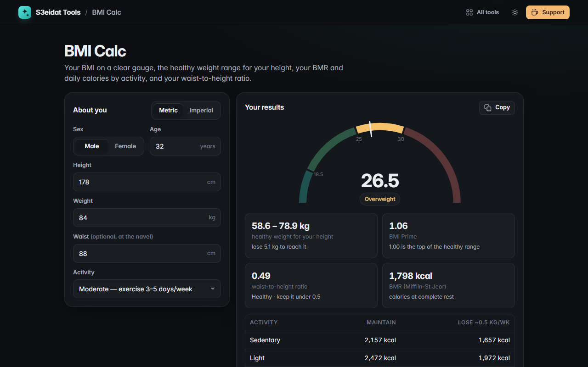

# BMI Calc

> BMI with a category gauge, healthy weight range, BMR, daily calories and waist-to-height ratio. Free, private, and it runs entirely in your browser.

### ▶ [Open BMI Calc](https://s3eidat.github.io/bmi-calc/)



## Features

- **Metric or imperial** (cm/kg or ft-in/lb); switching converts what you typed
- **BMI** with the WHO adult category on a colour **gauge**, plus **BMI Prime**
- **Healthy weight range** for your height, and how far you are from it
- **BMR** with the Mifflin-St Jeor formula and **daily calories** for five activity levels
- **Waist-to-height ratio** (optional) with the simple keep-it-under-0.5 guide
- Adult-only formulas are flagged for under-18s; copy a short summary; inputs remembered on this device

**Not medical advice.** BMI and these formulas are population screening estimates for adults. They do not account for muscle mass, frame, pregnancy or ethnicity. Talk to a doctor or dietitian about your health.

## Privacy

Your body measurements never leave your device. There is no server, no account, no analytics.
The page ships with a strict Content-Security-Policy (`connect-src 'self'`), so the browser
itself blocks any attempt to send data anywhere.

## Run it yourself

It's plain HTML, CSS and JavaScript with no build step:

```bash
git clone https://github.com/s3eidat/bmi-calc
cd bmi-calc
python -m http.server 8000
```

Then open http://localhost:8000.

## Support

If this saved you time, **[buy me a coffee ☕](https://s3eidat.github.io/coffee/)**. It keeps every tool free.

---

Part of **[S3eidat Tools](https://s3eidat.github.io/)**: 100+ free, private tools that run in your browser. MIT licensed.
